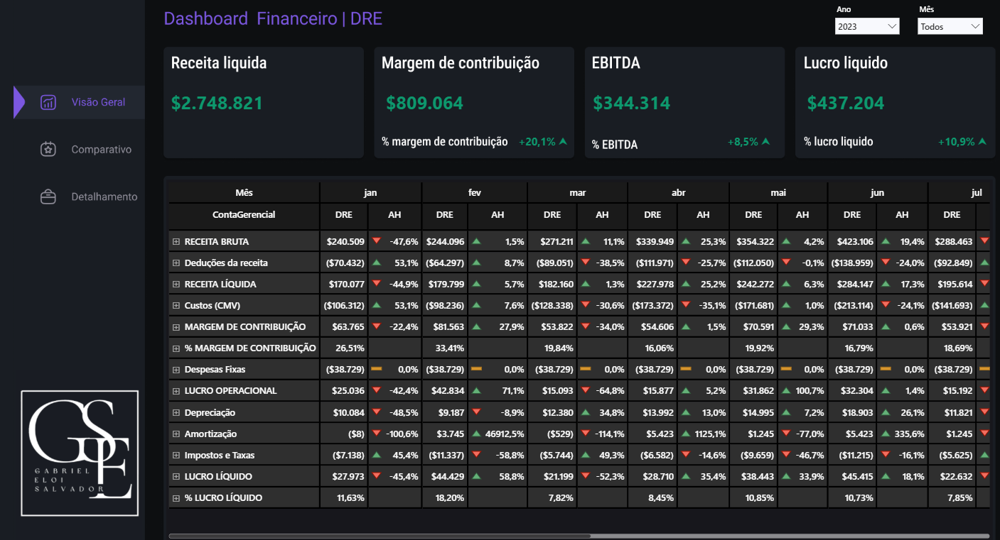
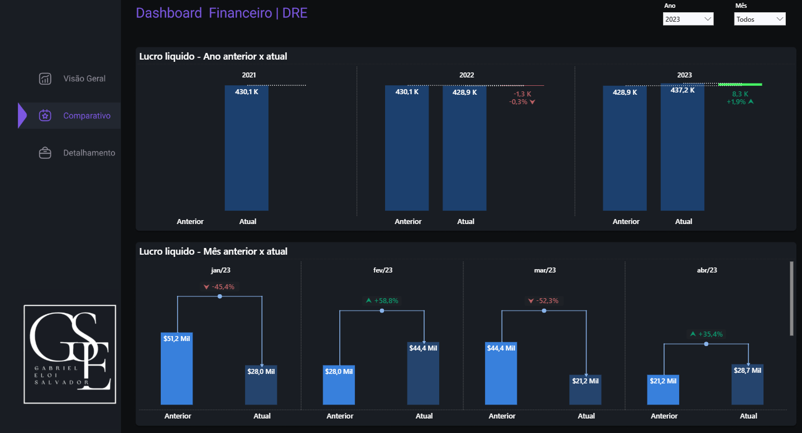
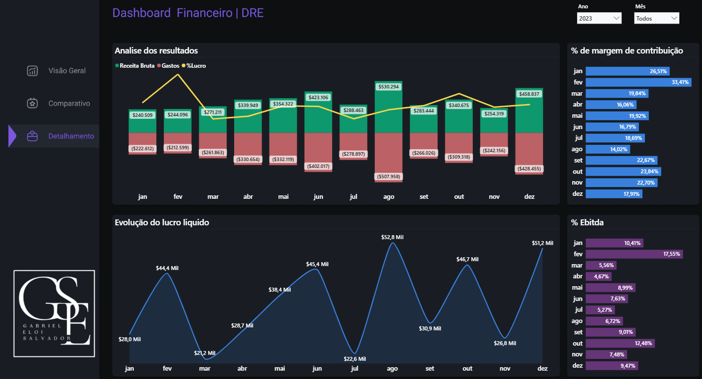

# Gabriel Eloi Salvador | Portfólio de Business Intelligence

Analista de Dados e Business Intelligence, com experiência nos segmentos financeiro e agronegócio.

Site do portfólio: https://geddsilva.github.io/portfolio-bi/

LinkedIn: https://linkedin.com/in/gabriel-eloi

Todos os projetos usam **dados fictícios**. Os painéis são públicos e interativos.

## Projetos

| Projeto | Descrição | Painel |
|---|---|---|
| Dashboard Financeiro, DRE | Receita líquida, margem de contribuição, EBITDA e lucro líquido em uma única visão, com análise horizontal e comparativos. | [Abrir painel](https://app.powerbi.com/view?r=eyJrIjoiYmU2M2UzYmEtOGJmNy00OTg2LTkyODgtY2FkOTRiYzk1ZDViIiwidCI6IjE4NTFiYTg5LWMwNDQtNDMzMy05NDA5LWQ4MGE3NGFmNWY0MiJ9) |

---

## Dashboard Financeiro, DRE

Dashboard de DRE financeira em Power BI, com dados fictícios, para acompanhar receita líquida, margem de contribuição, EBITDA e lucro líquido em uma única visão.

**Visão Geral:** indicadores principais com variação percentual e DRE mensal por conta gerencial, com análise horizontal (AH).

**Comparativo:** lucro líquido do ano anterior contra o atual e de cada mês contra o mês anterior.

**Detalhamento:** evolução de receita, gastos e margem ao longo do ano, com margem de contribuição e EBITDA por mês.

Filtros por ano e mês em todas as páginas.

**Ferramentas:** Power BI, DAX, Power Query.

[Abrir o painel interativo](https://app.powerbi.com/view?r=eyJrIjoiYmU2M2UzYmEtOGJmNy00OTg2LTkyODgtY2FkOTRiYzk1ZDViIiwidCI6IjE4NTFiYTg5LWMwNDQtNDMzMy05NDA5LWQ4MGE3NGFmNWY0MiJ9)
