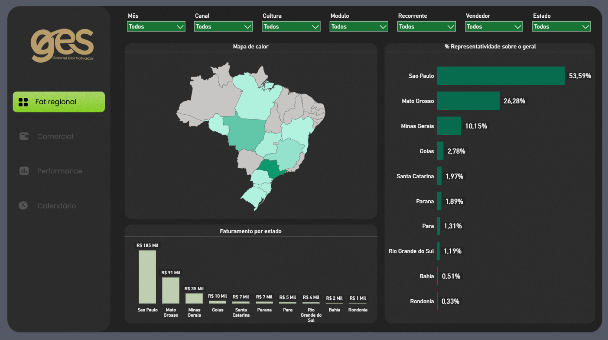
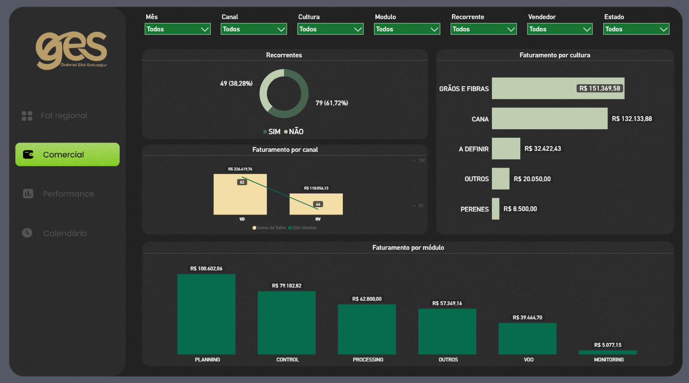
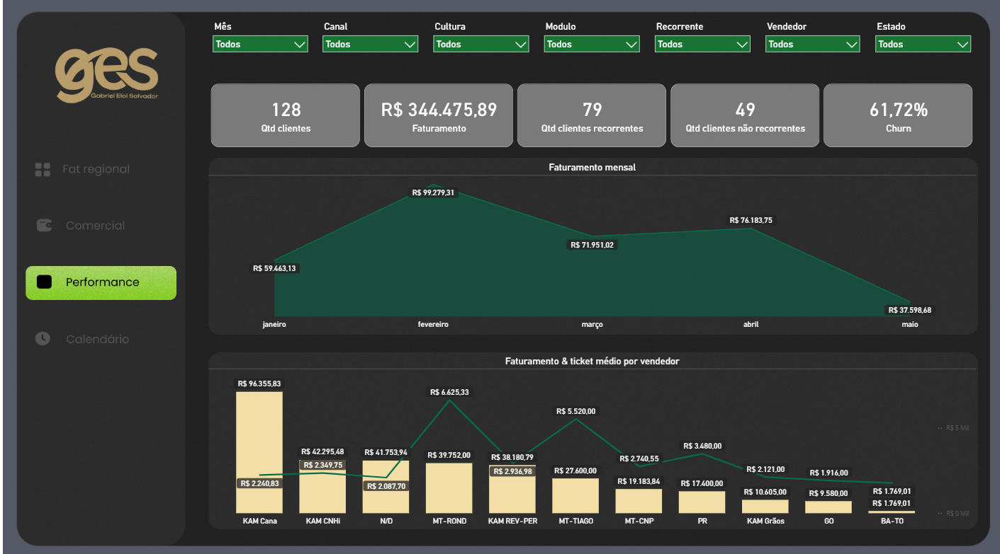
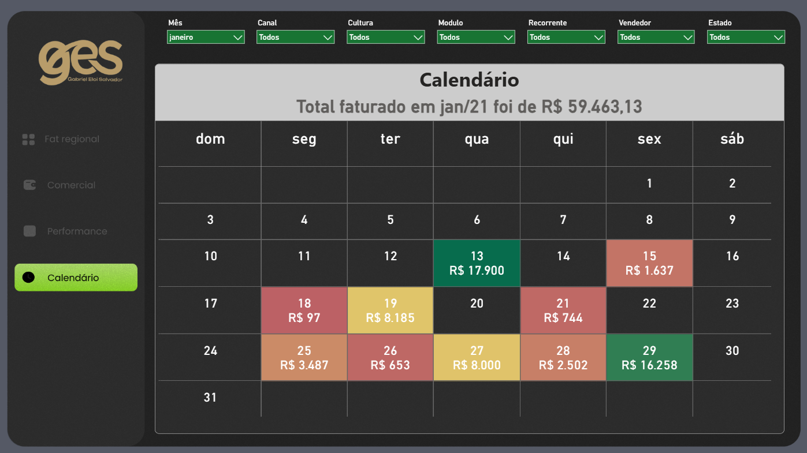
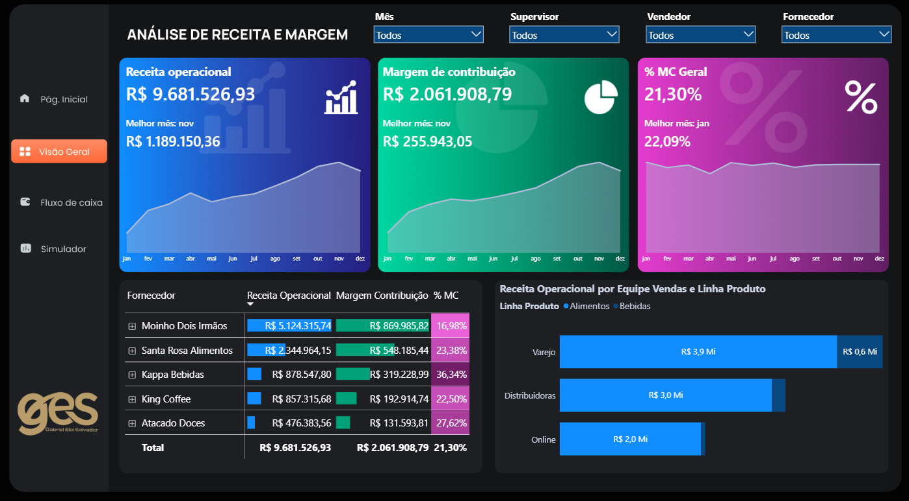
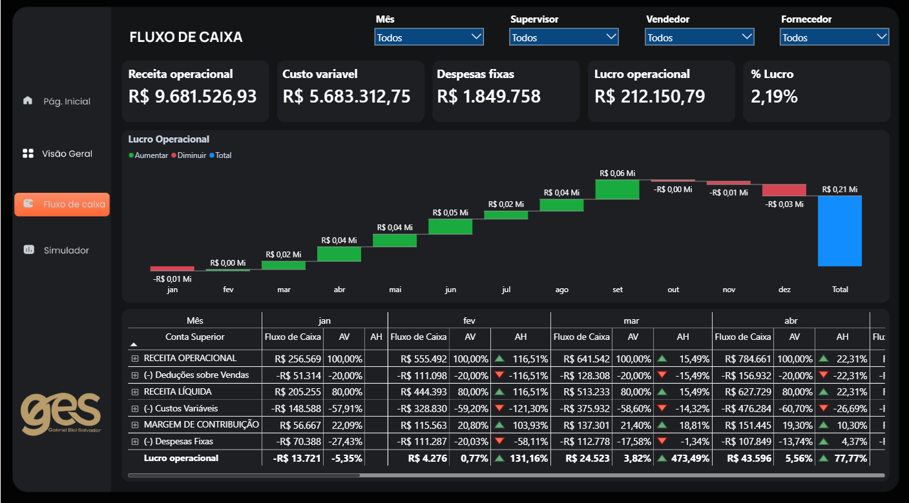
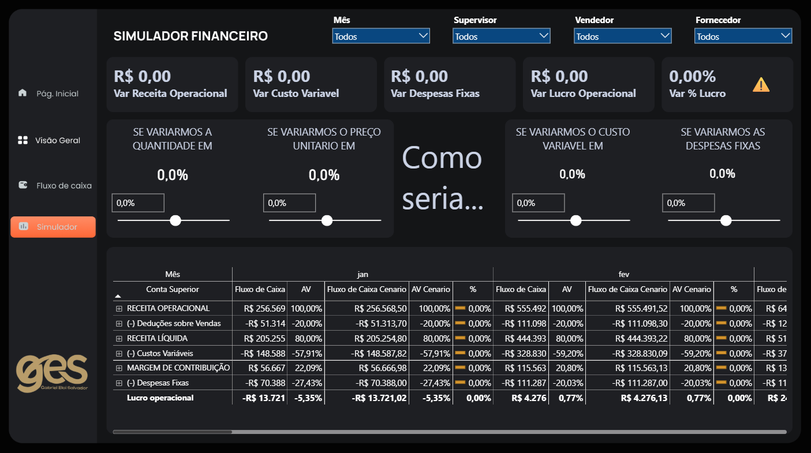

# Gabriel Eloi Salvador | Portfólio de Business Intelligence

Analista de Dados e Business Intelligence, com experiência nos segmentos financeiro e agronegócio.

Site do portfólio: https://geddsilva.github.io/portfolio-bi/

LinkedIn: https://linkedin.com/in/gabriel-eloi

Todos os projetos usam **dados fictícios**. Os painéis são públicos e interativos.

## Projetos

| Projeto | Descrição | Painel |
|---|---|---|
| Dashboard Financeiro, DRE | Receita líquida, margem de contribuição, EBITDA e lucro líquido em uma única visão, com análise horizontal e comparativos. | [Abrir painel](https://app.powerbi.com/view?r=eyJrIjoiYmU2M2UzYmEtOGJmNy00OTg2LTkyODgtY2FkOTRiYzk1ZDViIiwidCI6IjE4NTFiYTg5LWMwNDQtNDMzMy05NDA5LWQ4MGE3NGFmNWY0MiJ9) |
| Painel de Performance e Faturamento | Faturamento por estado, canal, cultura e módulo, recorrência de clientes, evolução mensal e performance por vendedor. | [Abrir painel](https://app.powerbi.com/view?r=eyJrIjoiMWY1NDc3MjUtZDcwNS00ODAxLTkxODAtNGY5NGU0YWFlNTk3IiwidCI6IjE4NTFiYTg5LWMwNDQtNDMzMy05NDA5LWQ4MGE3NGFmNWY0MiJ9) |
| Simulador Financeiro | Resultado real da operação com análise de sensibilidade: ajuste de quantidade, preço, custo variável e despesas fixas. | [Abrir painel](https://app.powerbi.com/view?r=eyJrIjoiZTEwMmU0NDItMGJiNS00ZTIyLWI5YzYtZmQyNWJiNTEzZmE5IiwidCI6IjE4NTFiYTg5LWMwNDQtNDMzMy05NDA5LWQ4MGE3NGFmNWY0MiJ9) |

---

## Dashboard Financeiro, DRE

Dashboard de DRE financeira em Power BI, com dados fictícios, para acompanhar receita líquida, margem de contribuição, EBITDA e lucro líquido em uma única visão.

**Visão Geral:** indicadores principais com variação percentual e DRE mensal por conta gerencial, com análise horizontal (AH).

**Comparativo:** lucro líquido do ano anterior contra o atual e de cada mês contra o mês anterior.

**Detalhamento:** evolução de receita, gastos e margem ao longo do ano, com margem de contribuição e EBITDA por mês.

Filtros por ano e mês em todas as páginas.

**Ferramentas:** Power BI, DAX, Power Query.

[Abrir o painel interativo](https://app.powerbi.com/view?r=eyJrIjoiYmU2M2UzYmEtOGJmNy00OTg2LTkyODgtY2FkOTRiYzk1ZDViIiwidCI6IjE4NTFiYTg5LWMwNDQtNDMzMy05NDA5LWQ4MGE3NGFmNWY0MiJ9)

---

## Painel de Performance e Faturamento

Dashboard de faturamento e performance comercial em Power BI, com dados fictícios, para acompanhar a operação de vendas em uma única visão.

**Fat regional:** mapa de calor e faturamento por estado, com a representatividade de cada um sobre o total.

**Comercial:** faturamento por canal, cultura e módulo, e análise de recorrência dos clientes.

**Performance:** indicadores de clientes e faturamento, evolução mensal e faturamento com ticket médio por vendedor.

**Calendário:** faturamento por dia do mês, com cores por faixa de valor.

Filtros por mês, canal, cultura, módulo, recorrência, vendedor e estado em todas as páginas.

**Ferramentas:** Power BI, DAX, Power Query.

[Abrir o painel interativo](https://app.powerbi.com/view?r=eyJrIjoiMWY1NDc3MjUtZDcwNS00ODAxLTkxODAtNGY5NGU0YWFlNTk3IiwidCI6IjE4NTFiYTg5LWMwNDQtNDMzMy05NDA5LWQ4MGE3NGFmNWY0MiJ9)

---

## Simulador Financeiro

Simulador financeiro em Power BI, com dados fictícios, que parte do resultado real da operação e permite testar cenários.

**Visão Geral:** receita operacional, margem de contribuição e % MC por mês, por fornecedor e por equipe de vendas.

**Fluxo de caixa:** DRE mensal com análise vertical (AV) e horizontal (AH), e gráfico de cascata do lucro operacional.

**Simulador:** análise de sensibilidade com ajuste de quantidade, preço unitário, custo variável e despesas fixas (e se o preço subisse 5%? e se as despesas caíssem 10%?), comparando o cenário com o resultado real.

Filtros por mês, supervisor, vendedor e fornecedor.

**Ferramentas:** Power BI, DAX, Power Query.

[Abrir o painel interativo](https://app.powerbi.com/view?r=eyJrIjoiZTEwMmU0NDItMGJiNS00ZTIyLWI5YzYtZmQyNWJiNTEzZmE5IiwidCI6IjE4NTFiYTg5LWMwNDQtNDMzMy05NDA5LWQ4MGE3NGFmNWY0MiJ9)
